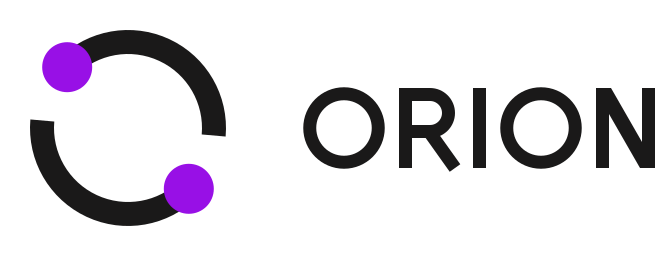
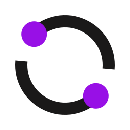
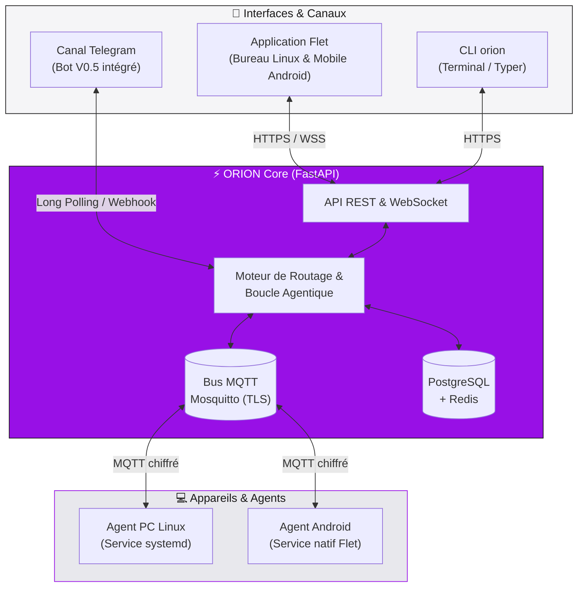

<p align="center">
  <picture>
    <source media="(prefers-color-scheme: dark)" srcset="assets/logo-dark.svg">
    <source media="(prefers-color-scheme: light)" srcset="assets/logo-light.svg">
    
  </picture>
</p>

<h3 align="center">Assistant personnel autonome, multi-appareils et multidirectionnel</h3>

<p align="center">
  <em>Du MVP pratique à un assistant inspiré de Jarvis — Conçu pour piloter n'importe lequel de vos appareils depuis n'importe quel autre, sans compromis sur la sécurité.</em>
</p>

<p align="center">
  
  
  
  
</p>

---

## 🌌 À propos d'ORION

**ORION** est un assistant personnel interconnecté dont la règle fondamentale est la **multidirectionnalité** : il reçoit un ordre sur **n'importe lequel** de vos appareils et l'exécute sur **n'importe quel autre**.

- **Depuis votre téléphone (en 4G) :** Récupérer un document sur votre PC, déclencher une sauvegarde, vérifier l'état des disques ou capturer l'écran.
- **Depuis votre PC :** Récupérer les photos du jour prises sur votre smartphone, envoyer un document, localiser votre téléphone ou le faire sonner même en silencieux.
- **Depuis Telegram :** Piloter vos appareils à distance via une messagerie sécurisée, sans ouvrir le moindre port sur votre box.

Le projet poursuit deux objectifs indissociables :
1. **Construire un outil fiable et utile au quotidien**, sans dépendre d'un cloud tiers fermé pour nos données privées.
2. **Suivre un parcours d'ingénierie complet**, du système bas niveau (Linux, services systemd) aux agents IA autonomes (LLM, MCP, RAG), en passant par le réseau (MQTT, Tailscale), le mobile (Android/Flet) et la sécurité (Zero-Trust).

> **💡 La règle d'or d'ORION :** Chaque version (de V0 à V9) apporte une capacité directement utilisable et introduit un nombre limité de technologies nouvelles. On ne passe à la version suivante que lorsque la précédente est fonctionnelle, testée, et que chaque ligne de code est maîtrisée.

---

## 🎨 Identité Visuelle : Le Concept B

Le logo d'ORION est issu du **Concept 1 (Variante B : « Le O réciproque »)**.

<p align="center">
  
</p>

- **Deux arcs en miroir et deux nœuds cardinaux :** Ils illustrent la communication symétrique et continue entre les appareils (PC ⇄ Mobile).
- **Le « O » d'Orion :** Un cercle ouvert et dynamique qui rappelle la constellation d'Orion et la boucle d'interaction perpétuelle de l'assistant.
- **Palette officielle :**
  - **Encre (`#1a1919`) :** Précision, stabilité et élégance.
  - **Violet Orion (`#9810e6`) / Violet clair (`#b15cf0`) :** Intelligence, énergie et signature visuelle nocturne.

---

## 📍 État Actuel du Projet : V0 & V0.5

Le projet est actuellement à l'étape des versions **V0 (Atelier)** et **V0.5 (Messager)**.

```text
[ V0 - Atelier ]  ──▶  [ V0.5 - Messager ]  ──▶  ( V1 - Pont : Prochaine étape )
     ✅ Prêt                 ✅ Opérationnel                 ⏳ En préparation
```

### 1. V0 — Atelier (Socle de développement)
- [x] Configuration de l'environnement Linux natif.
- [x] Socle Python 3.12+ avec gestion d'environnement virtuel.
- [x] Outils d'analyse statique et de formatage de code (`Ruff`).
- [x] Configuration `.gitignore` stricte protégeant tous les secrets et fichiers temporaires.
- [x] Banc d'essai mobile/desktop avec Flet (`Training/`).
- [x] Cahier des charges exhaustif et document d'architecture (`ORION_Cahier_des_charges.md`).

### 2. V0.5 — Messager (Bot Telegram opérationnel)
Situé dans le dossier `Bot/`, ce module offre une première victoire concrète : piloter le PC depuis son smartphone via Telegram, sans ouverture de port grâce au *long polling*.

**Fonctionnalités déjà implémentées (`Bot/bot.py`) :**
- 🔹 **/start** : Accueil personnalisé et vérification du statut du bot.
- 🔹 **/help** & **/menu** : Liste interactive des commandes disponibles.
- 🔹 **/ls `[dossier]`** : Explorateur de fichiers interactif sous forme de boutons en ligne (*Inline Keyboard*) :
  - Navigation dynamique dans les dossiers (dossier parent, sous-dossiers).
  - Cache MD5 des chemins pour contourner la limite stricte de 64 octets imposée par l'API Telegram (`callback_data`).
  - Pagination automatique (30 premiers éléments par vue).
- 🔹 **/getfile `<chemin>`** ou **clic sur un fichier** : Téléchargement direct et sécurisé d'un fichier du PC vers la discussion Telegram.
- 🔹 **Réception automatique de documents et photos** : Tout fichier envoyé dans la conversation est automatiquement sauvegardé sur le PC dans le dossier `~/reçus`.
- 🛡️ **Sécurité des chemins** : Confinement strict dans le dossier utilisateur personnel (`is_relative_to(RACINE)`), interdisant tout accès non autorisé au reste du système.

---

## 🗺️ Feuille de Route Globale (Roadmap V0 → V9)

| Version | Nom | Capacité ajoutée | Technologies clés | Statut |
| :---: | :--- | :--- | :--- | :---: |
| **V0** | **Atelier** | Environnement de développement, outillage et conventions | Linux, Python 3.12+, Git, Ruff, Flet | ✅ **Terminé** |
| **V0.5** | **Messager** | Bot Telegram autonome : exploration et transfert de fichiers | Telegram Bot API, `python-telegram-bot`, `asyncio` | 🚀 **Actuel (Opérationnel)** |
| **V1** | **Pont** | Téléphone ⇄ PC bidirectionnel : fichiers, scripts, écran, sonnerie | FastAPI, MQTT (Mosquitto), PostgreSQL, Redis, Flet, Tailscale | ⏳ *Prochaine étape* |
| **V2** | **Mémoire** | Recherche par le sens, mémoire vectorielle des fichiers et préférences | Embeddings, Qdrant, sentence-transformers | 📋 Planifié |
| **V3** | **Cerveau** | Demandes libres multi-étapes, boucle agentique, validation humaine | API LLM, Ollama, MCP (Model Context Protocol) | 📋 Planifié |
| **V4** | **Voix** | Entendre et parler à ORION en temps réel | Whisper, VAD (Silero), Piper, WebRTC | 📋 Planifié |
| **V5** | **Veille** | Alertes proactives, briefings matinaux, SMS/notifications téléphone sur PC | APScheduler, push FCM, Prometheus, Grafana | 📋 Planifié |
| **V6** | **Regard** | Vision par ordinateur, OCR, compréhension de l'écran | XDG Desktop Portal, ydotool, PaddleOCR, scrcpy | 📋 Planifié |
| **V7** | **Maison** | Pilotage domotique et environnement physique | Home Assistant, Zigbee2MQTT | 📋 Planifié |
| **V8** | **Équipe** | Équipe d'agents autonomes spécialisés collaborant sur des objectifs | Systèmes multi-agents, LangGraph | 📋 Planifié |
| **V9** | **Jarvis** | Autonomie encadrée, intégration totale, finition haut de gamme | Sécurité Zero-Trust renforcée, UX unifiée | 🎯 Vision Finale |

---

## 🏗️ Architecture Globale Cible

ORION repose sur une architecture en étoile sécurisée :



---

## 📂 Structure du Répertoire

Le projet est organisé en monorepo, structuré comme suit :

```text
ORION/
├── assets/                     # Logos officiels (Concept B) et ressources graphiques
│   ├── logo.svg                # Logo adaptatif (thème clair/sombre)
│   ├── logo-light.svg          # Version thème clair
│   ├── logo-dark.svg           # Version thème sombre
│   └── logo-symbol.svg         # Symbole seul (O réciproque)
├── Bot/                        # [V0.5] Bot Telegram autonome
│   ├── bot.py                  # Code principal du bot (asyncio, telegram.ext)
│   ├── .env.example            # Modèle des variables d'environnement requises
│   └── reçus/                  # Dossier de réception des fichiers envoyés via Telegram
├── Training/                   # [V0] Laboratoire d'apprentissage et tests Flet
│   ├── src/                    # Prototype d'application Flet
│   └── pyproject.toml          # Dépendances du banc d'essai
├── logo/                       # Dossier des concepts graphiques et maquettes
│   ├── concepts/               # Concepts 1 (A, B, C)
│   └── kit/                    # Kit graphique complet et spécifications
├── ORION_Cahier_des_charges.md # Cahier des charges exhaustif de référence
├── .gitignore                  # Exclusion stricte des données sensibles, venv et caches
└── README.md                   # Ce document
```

> *Note : Au fur et à mesure du déploiement de la V1 et des versions suivantes, les dossiers `core/`, `agent/`, `app/`, `cli/`, `infra/` et `docs/` s'ajouteront selon l'arborescence définie au Chapitre 20 du cahier des charges.*

---

## 🚀 Démarrage Rapide (Tester la V0.5)

### 1. Prérequis
- Un système **Linux** (Ubuntu 24.04 LTS ou Debian 12 recommandés).
- **Python 3.12+** installé.
- Un compte Telegram et un bot créé via [@BotFather](https://t.me/BotFather) pour obtenir un jeton d'accès (`BOT_TOKEN`).

### 2. Configuration du Bot
1. Déplacez-vous dans le dossier du bot :
   ```bash
   cd Bot
   ```
2. Créez votre environnement virtuel et activez-le :
   ```bash
   python3 -m venv .venv
   source .venv/bin/activate
   ```
3. Installez les dépendances :
   ```bash
   pip install python-telegram-bot python-dotenv httpx
   ```
4. Créez votre fichier de configuration `.env` à partir du modèle :
   ```bash
   cp .env.example .env
   ```
5. Renseignez votre jeton dans le fichier `.env` :
   ```env
   BOT_TOKEN="1234567890:ABCdefGHIjklMNOpqrsTUVwxyz"
   ```

### 3. Lancement
Lancez le bot en tâche locale :
```bash
python3 bot.py
```
Ouvrez votre application Telegram sur votre smartphone, recherchez votre bot et tapez `/start`. Vous pouvez dès à présent parcourir les dossiers de votre PC avec `/ls` et télécharger vos documents instantanément !

---

## 🔒 Principes de Sécurité

La sécurité n'est pas ajoutée après coup, elle fait partie intégrante de la conception d'ORION dès le premier jour :
- **Zero-Trust & Moindre privilège :** Aucun appareil n'a de droit absolu sur les autres sans contrôle.
- **Confinement du système de fichiers :** Toute commande de lecture ou d'écriture passe par une vérification de chemin strict (`safe_path`) interdisant les traversées de répertoire (`../`).
- **Secrets hermétiques :** Aucun jeton API ni mot de passe n'est versionné dans Git. Le `.gitignore` bloque rigoureusement tout fichier sensible.
- **Canal privé :** Dès la V1, toutes les communications réseau hors Telegram transitent par un réseau maillé chiffré **Tailscale** (WireGuard) et du chiffrement TLS bout-en-bout.

---

## 👤 Auteur & Références

- **Auteur :** Jean Emmanuel Ahossi
- **Spécification :** [ORION — Cahier des charges (v1.3)](ORION_Cahier_des_charges.md)
- **Licence :** Projet personnel de formation et de recherche — Tous droits réservés.
